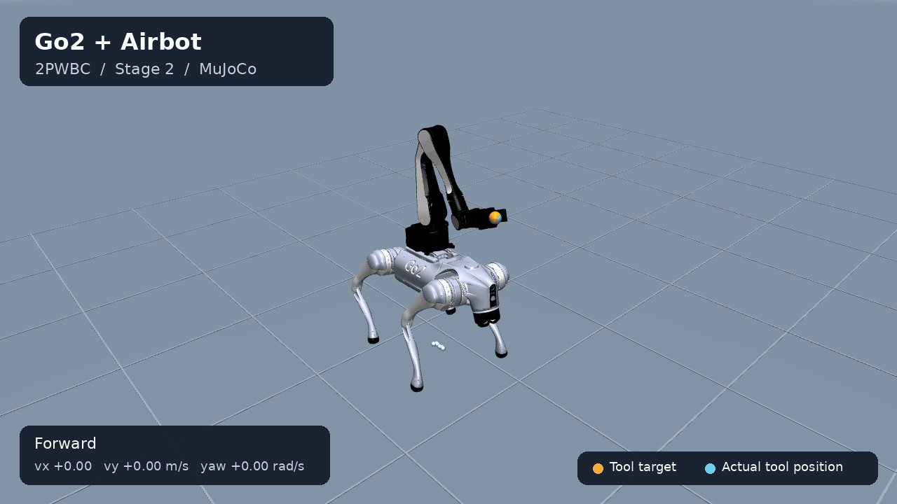
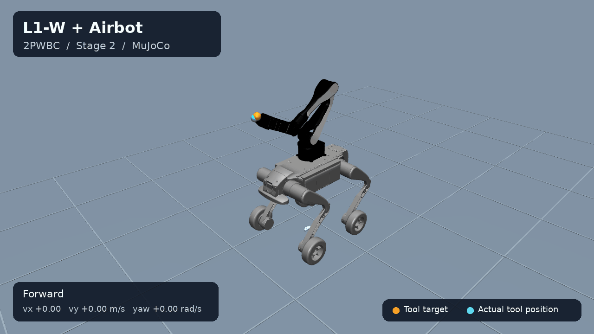

# 2PWBC · Whole-Body Control on UniLab

**2PWBC (2 Policy Whole-Body Control)** coordinates locomotion and manipulation for Go2 and L1-W robots equipped with Airbot arms. In MuJoCo, the robots track end-effector targets while moving in any planar direction. The locomotion and arm policies learn through a shared differentiable world model (WM) using backpropagation through time (BPTT).

[简体中文](README_zh.md) · [Training and playback](migration/README.md) · [Project layout](docs/README.md)

## Stage 2 demonstrations

The same command sequence runs on both robots in MuJoCo. Each robot moves forward and backward, strafes in both directions, and turns left and right while tracking a continuous tool trajectory in the robot's heading-aligned frame. The arm sweeps side to side and makes three forward-and-down reaches during each run. The amber dot marks the target, the cyan dot marks the measured tool position, and the blue arrow shows the commanded planar motion. White floor dots trace the actual base path.

| Go2 + Airbot · Quadruped | L1-W + Airbot · Wheel-legged |
| --- | --- |
| [](docs/media/go2-stage2.gif) | [](docs/media/l1w-stage2.gif) |

Both GIFs use the locally trained Stage 2 checkpoint `model_34999.pt` for their respective robots. The GIFs are included in this repository. To run playback yourself, use a compatible checkpoint from your own training run or an existing local copy.

## How 2PWBC works

- **Whole-body control.** The arm policy produces arm joint targets and plans body pitch and roll. The locomotion policy takes that plan in the same control step, alongside the commanded base velocity, so the base can adjust its posture as the arm reaches.
- **Differentiable world model.** A learned dynamics model fits MuJoCo trajectories and predicts how the base and joints respond to control targets. It rolls the two policies forward together and evaluates locomotion and end-effector tracking rewards along the predicted trajectory.
- **BPTT.** Gradients from the multi-step return flow backward through the predicted states and the policy coupling. This lets the arm policy learn how its body plan affects future locomotion and end-effector tracking.

## Quick start

From the repository root on Linux, with [uv](https://docs.astral.sh/uv/) and Python 3.10–3.13:

```bash
uv sync
uv run legged-assets
uv run legged-train --task go2 --cfg stage=stage1
```

The asset command prints the cache directory for the bundled robot models. The config check prints the resolved Go2 Stage 1 settings and exits. Use `--task l1w` to check the L1-W configuration.

If you already have a compatible checkpoint, set `STAGE2_RUN` to its file path or enclosing run directory and open the MuJoCo viewer:

```bash
uv run 2pwbc-play --run "${STAGE2_RUN}" --device cpu
```

When you pass a run directory, playback selects the highest-numbered `model_*.pt` by default. Pass a specific checkpoint file to select an exact iteration. Playback restores the robot and training stage from the selected checkpoint. Use the up/down arrows for forward/backward, left/right arrows to turn, and `7`/`8` to strafe. In Stage 2, `U`/`J`, `H`/`K`, and `Y`/`O` move the tool target along its three axes. Use `--no-keyboard` to run with sampled task commands.

## Train both stages

```bash
CUDA_VISIBLE_DEVICES=0 bash train_2pwbc.sh --task go2 \
  1024 5000 30000 training.device=cuda:0 training.compile=true algo.utd=0.4
```

Choose `--task l1w` for L1-W. The three numbers set the parallel environments, Stage 1 updates, and additional Stage 2 updates. The launcher initializes Stage 2 from the final Stage 1 checkpoint and prints both run directories under `logs/2pwbc-mujoco/`.

- **Stage 1** freezes the arm while the locomotion policy learns to follow velocity, pitch, and roll commands.
- **Stage 2** enables the arm policy and trains both policies on locomotion and end-effector tracking. At playback, the policies control MuJoCo directly.
- **L1-W** adds four wheel velocity targets to the leg and arm position targets and uses a command-gated gait clock.

See the [training guide](migration/README.md) for resuming a run, checkpoint compatibility, and TensorBoard.

## Change the task or controller

| To change | Start here |
| --- | --- |
| Robot commands, controls, or rewards | [Go2 task config](src/legged_manipulation_unilab/conf/wbc2p/task/go2/) · [L1-W task config](src/legged_manipulation_unilab/conf/wbc2p/task/l1w/) |
| World model, replay, or policy training settings | [Shared training config](src/legged_manipulation_unilab/conf/wbc2p/config.yaml) |
| Robot models, meshes, or scenes | [Bundled robot assets](src/legged_manipulation_unilab/assets/robots/) |

See the [project license](LICENSE) and [source and asset notices](NOTICE.md).

## Reference repositories

- [UniLab](https://github.com/Motphys/UniLab)
- [SuperMimic](https://github.com/HybridRobotics/supermimic)
- [RoboDuet](https://github.com/locomanip-duet/RoboDuet)
- [legged-manipulation_unilab](https://github.com/unilabsim/legged-manipulation_unilab)
