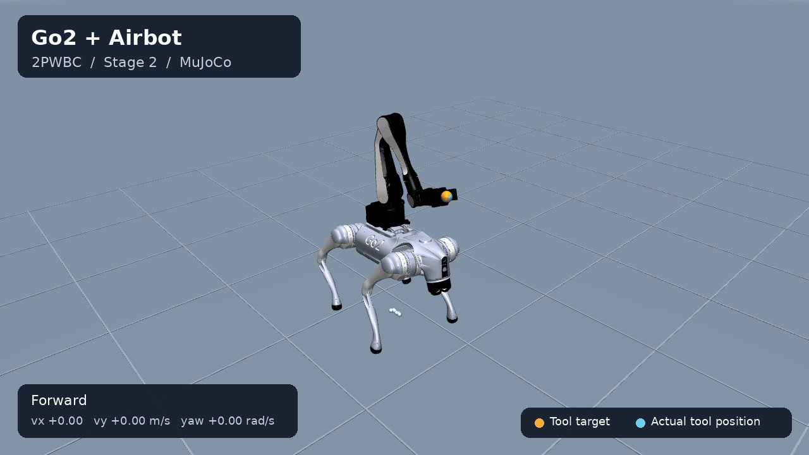
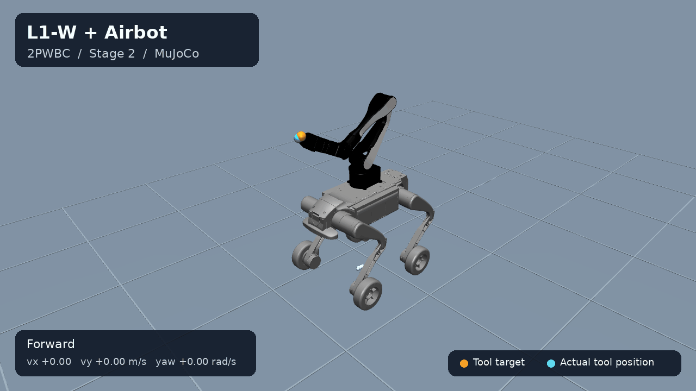
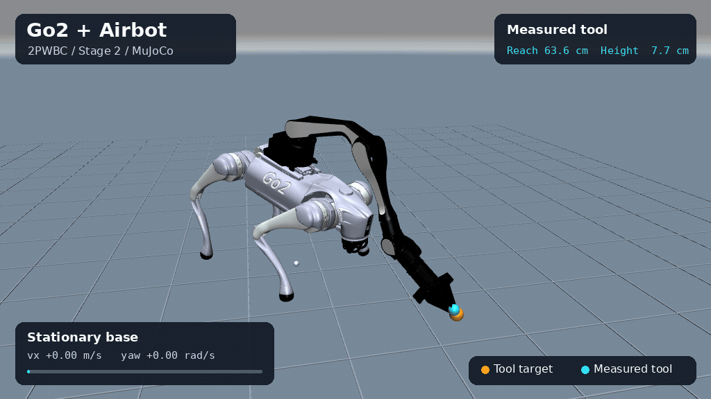
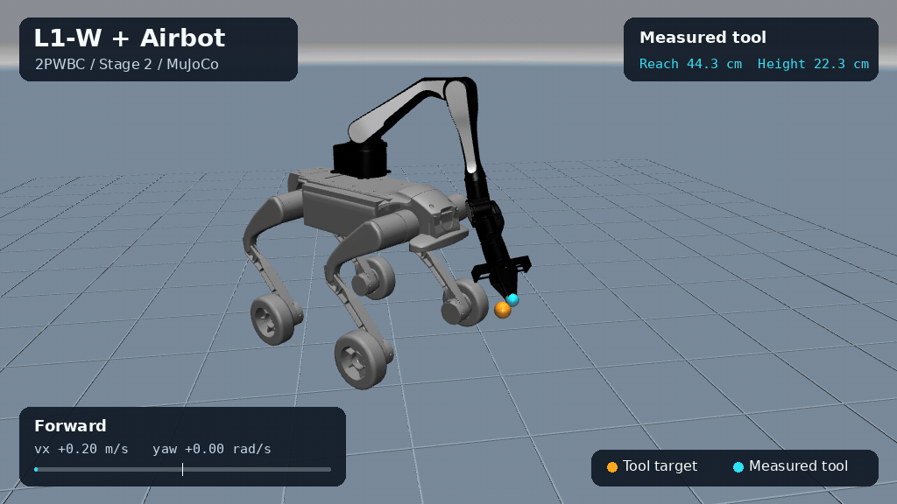

# 2PWBC · 基于 UniLab 的全身控制

**2PWBC（2 Policy Whole-Body Control，双策略全身控制）**协调搭载 Airbot 机械臂的 Go2 四足机器人和 L1-W 轮足机器人的移动与操作，使其在 MuJoCo 中全向移动的同时跟踪末端目标。底盘和机械臂策略共享一个可微世界模型（WM），通过时间反向传播（BPTT）训练。

[English](README.md) · [训练与回放](migration/README.md) · [工程结构](docs/README.md)

## Stage 2 演示

两台机器人在 MuJoCo 中执行相同的指令序列，展示前进、后退、左右横移和左右转向，同时跟踪机器人航向对齐坐标系下的连续末端轨迹。每段演示中，机械臂左右扫动，并三次向前下方伸展。橙点是末端目标，青点是测得的末端位置，蓝色箭头表示底盘平移指令，地面白点记录底盘的实际轨迹。

| Go2 + Airbot · 四足 | L1-W + Airbot · 轮足 |
| --- | --- |
| [](docs/media/go2-stage2.gif) | [](docs/media/l1w-stage2.gif) |

演示分别使用两台机器人本地训练的 Stage 2 checkpoint，文件名均为 `model_34999.pt`。仓库提供演示 GIF。要运行回放，请使用本地已有的兼容权重，或按下文完成训练后使用生成的权重。

### 足臂协同扩大末端工作空间

两台机器人都演示了向前伸展、贴近地面横扫和抬臂收回。Go2 全程给定零底盘速度指令，原地调整机身姿态配合机械臂。L1-W 前 **2 秒**给定 **0.20 m/s** 的前进速度，后 **2 秒**保持前进并叠加 **+0.20 rad/s** 的左转角速度。每段 GIF 长 **4 秒**，画面显示实测的末端前伸距离和离地高度。

| Go2 + Airbot · 四足 | L1-W + Airbot · 轮足 |
| --- | --- |
| [](docs/media/go2-stage2-low-reach.gif) | [](docs/media/l1w-stage2-low-reach.gif) |
| 最大前伸 **63.6 cm**，最低离地 **3.1 cm** | 最大前伸 **63.0 cm**，最低离地 **5.3 cm** |

Go2 沿用原演示的 Stage 2 权重，即 11 月 24 日训练的 `model_34999.pt`。L1-W 使用 11 月 25 日训练的 Stage 2 权重 `model_34999.pt`。

## 2PWBC 的工作原理

- **全身控制。** 机械臂策略输出关节目标，并规划机身俯仰和横滚。底盘策略在同一控制步接收该规划和底盘速度指令，使机身在机械臂伸展时同步调整姿态。
- **可微世界模型。** 动力学模型从 MuJoCo 轨迹中学习底盘和关节如何响应控制目标，用于联合展开两个策略，并沿预测轨迹计算移动与末端跟踪奖励。
- **BPTT。** 多步回报的梯度沿预测状态与两个策略之间的耦合关系反向传播，让机械臂策略学到其机身姿态规划对后续移动与末端跟踪的影响。

## 快速开始

在 Linux 上安装 [uv](https://docs.astral.sh/uv/) 和 Python 3.10–3.13，然后在仓库根目录执行：

```bash
uv sync
uv run legged-assets
uv run legged-train --task go2 --cfg stage=stage1
```

资产命令会输出随项目提供的机器人模型缓存目录。配置检查会打印解析后的 Go2 Stage 1 参数并退出。用 `--task l1w` 可检查 L1-W 的配置。

已有兼容权重时，将 `STAGE2_RUN` 设为 checkpoint 文件路径或所在的运行目录，再打开 MuJoCo 查看器：

```bash
uv run 2pwbc-play --run "${STAGE2_RUN}" --device cpu
```

传入运行目录时，回放默认选用编号最大的 `model_*.pt`。要选择指定迭代，请直接传入对应的权重文件。回放会从所选权重恢复机器人和训练阶段。上下方向键控制前后，左右方向键控制转向，`7`/`8` 控制横移。Stage 2 中，`U`/`J`、`H`/`K`、`Y`/`O` 分别沿三个轴移动末端目标。加 `--no-keyboard` 可改用任务自动采样的指令。

## 两阶段训练

```bash
CUDA_VISIBLE_DEVICES=0 bash train_2pwbc.sh --task go2 \
  1024 5000 30000 training.device=cuda:0 training.compile=true algo.utd=0.4
```

用 `--task l1w` 切换到 L1-W。三个数字依次为并行环境数、Stage 1 更新数和 Stage 2 追加更新数。启动脚本使用 Stage 1 的最终 checkpoint 初始化 Stage 2，并输出 `logs/2pwbc-mujoco/` 下的两个运行目录。

- **Stage 1** 固定机械臂，训练底盘策略跟踪速度、俯仰和横滚指令。
- **Stage 2** 启用机械臂策略，联合训练两个策略完成移动与末端跟踪。回放时由两个策略直接控制 MuJoCo。
- **L1-W** 在腿和机械臂的关节位置目标之外增加四个轮速目标，并使用随速度指令启停的步态时钟。

续训、权重兼容和 TensorBoard 用法见[训练指南](migration/README.md)。

## 修改任务或控制器

| 修改目标 | 文件位置 |
| --- | --- |
| 机器人指令、控制或奖励 | [Go2 任务配置](src/legged_manipulation_unilab/conf/wbc2p/task/go2/) · [L1-W 任务配置](src/legged_manipulation_unilab/conf/wbc2p/task/l1w/) |
| 世界模型、经验回放或策略训练参数 | [共用训练配置](src/legged_manipulation_unilab/conf/wbc2p/config.yaml) |
| 机器人模型、网格或场景 | [随项目提供的机器人资产](src/legged_manipulation_unilab/assets/robots/) |

许可证及来源见[项目许可证](LICENSE)和[来源与资产声明](NOTICE.md)。

## 参考仓库

- [UniLab](https://github.com/Motphys/UniLab)
- [SuperMimic](https://github.com/HybridRobotics/supermimic)
- [RoboDuet](https://github.com/locomanip-duet/RoboDuet)
- [legged-manipulation_unilab](https://github.com/unilabsim/legged-manipulation_unilab)
